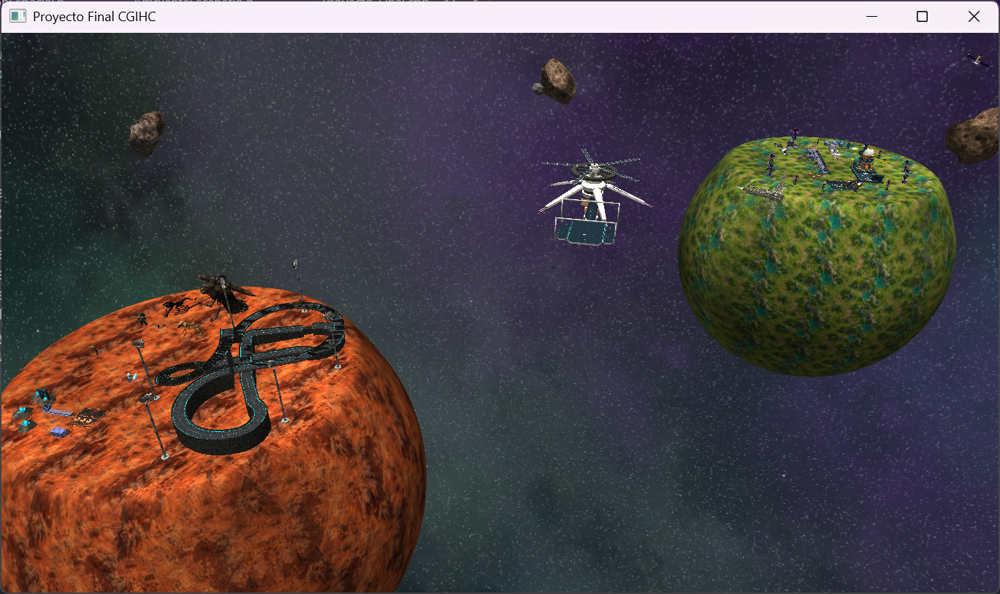

# Proyecto Final – Sistema Interplanetario

Proyecto final de teoría de **Computación Gráfica e Interacción Humano-Computadora**
Facultad de Ingeniería, UNAM · Semestre 2027-1 · Grupo 7

Ambiente virtual interactivo en **C++ y OpenGL 3.3** con las temáticas *Viajes espaciales* y *Evolución de especies intergalácticas*. La escena tiene dos planetas, un cinturón de asteroides, un satélite, una estación espacial entre ambos planetas, una pista de carreras, una plataforma de lanzamiento y personajes de distintos universos ficticios.

   

---

## Equipo

| Integrante | Personaje | Universo |
|---|---|---|
| Baeza Álvarez Isaura | Goku niño | Dragon Ball |
| De León López Alexis | Shigeo Kageyama "Mob" | Mob Psycho 100 |
| Loza Regino Miguel Ángel | Sigismund | Templarios Negros, Warhammer 40k |
| Romero Zamorano Rosa Jennifer | Rocky | Proyecto Hail Mary |

---

## Videos

- **Video del recorrido:** [Ver en YouTube](https://youtu.be/U6w5r9S_k4o)
- **Videoblog:** [Ver en YouTube](https://youtu.be/hbUBu4W4tTk)

---

## Contenido de la escena

La escena cuenta la **evolución de una especie intergaláctica**: en el planeta de extracción nace (nido de huevos y fauna primitiva) y en el de refinamiento vive ya evolucionada, junto a otras especies inteligentes que manejan la tecnología.

### Avatar
- **Pez alienígena con tentáculos** (personaje principal): modelo jerárquico de 19 piezas (cuerpo → cola → aleta y 8 tentáculos de dos segmentos). Camina sobre sus tentáculos en ola, mueve la cola como pez, tiene textura y material propio, y una linterna entre los ojos.

### Planeta 1 – Extracción (origen de las especies)
- **Nido de huevos** hechos con geometría por código. Con `E` el huevo grande eclosiona (animación por keyframes) y sale la cría de la especie del avatar.
- **Mina**: vetas de roca con cristales que brillan, torre de extracción con taladro animado, banda, acopio y luminaria.
- **Pista de carreras** en forma de 8 con **6 naves** compitiendo en dos carriles, cada una con la llama de sus dos propulsores, y **6 reflectores** que siguen a su nave.
- **Fauna hostil**: el Tillagemon (jefe, animado por piezas), un alien agachado, un alien de patas largas y un alien alado que vuela en círculos.
- **Sigismund** (armado por piezas, dispara su pistola bolter al Tillagemon) y **Mob** (levita con su aura psíquica y levanta rocas), acompañado de **Dimple**, que flota a su alrededor.

### Planeta 2 – Refinamiento (especies evolucionadas)
- **Refinería**: banda transportadora donde el mineral bruto se convierte en lingotes, refinadora y separadora con engranajes, depósitos, almacén, contenedores y paneles solares.
- **Plataforma de lanzamiento** con cohete, brazos de soporte, llamas del motor y humo.
- **Rocky** revisando la consola de la refinería, junto a la **figura de xenonita** de Grace; **Goku** volando en su nube.
- **Cápsula Saiyajin**: con `K` cae del cielo y rebota hasta quedar en su lugar (animación por keyframes).
- **Insectoide** (Ungubis eléctrica) que pasea por el planeta y el **Alien Hominid**, que lo sigue con la mirada.
- Vegetación alienígena.

### Espacio
- **Estación espacial** a la mitad entre los dos planetas, con muelle de atraque y dos lanzaderas que entran y salen.
- **Nave de transporte** que viaja planeta 1 → estación → planeta 2 → estación → planeta 1, con cuatro propulsores encendidos.
- **Nave de Proyecto Hail Mary** en órbita del planeta de refinamiento, con los brazos girando alrededor del casco.
- **Cinturón de asteroides** con forma y textura procedurales (cada asteroide es distinto).
- **Satélite** en órbita alrededor del planeta de refinamiento.
- **Skybox distinto para cada planeta**.

---

## Controles

### Cámaras

| Tecla | Cámara |
|---|---|
| `1` | Avatar en el planeta 1 (tercera persona, sobre el piso) |
| `2` | Avatar en el planeta 2 (tercera persona, sobre el piso) |
| `3` | Nave de transporte viajando entre planetas |
| `4` | Cámara panorámica libre |
| `5` | Nave de la carrera (tercera persona) |
| `6` | Plataforma de lanzamiento |
| `7` | Estación espacial y atraques |
| `8` | Seguir a una lanzadera de la estación |
| `9` | Goku en su nube |
| `0` | Vista de la refinería |
| `P` | Vista de la mina |

### Movimiento

| Tecla | Acción |
|---|---|
| `W` `A` `S` `D` | Caminar con el avatar / mover la cámara libre |
| Mouse | Girar la vista |
| `Shift` | Correr (x3 con el avatar, x10 en la cámara libre) |
| `Esc` | Salir |

### Interacciones

| Tecla | Acción |
|---|---|
| `L` | Prender / apagar la linterna del avatar (pez) |
| `Z` `X` `C` `G` `H` `N` | Prender / apagar cada reflector de la pista |
| `Q` | Prender / apagar todos los reflectores |
| `B` | Lanzar el cohete (cuenta atrás de 3 s) |
| `R` | Regresar el cohete a la plataforma |
| `V` | Ciclo del taladro de la mina |
| `M` | Pausar / reanudar la producción de la refinería |
| `T` | Ataque del Tillagemon: horquillazo |
| `Y` | Ataque del Tillagemon: azotón |
| `F` | Sigismund dispara tres veces al Tillagemon |
| `U` | Mob levita con su aura psíquica |
| `I` | Rocky inspecciona la consola |
| `E` | El huevo del nido eclosiona (keyframes) |
| `K` | La cápsula Saiyajin aterriza (keyframes) |

---

## Implementación

### Modelos jerárquicos
| Elemento | Archivo | Jerarquía |
|---|---|---|
| Avatar (pez alienígena) | `AvatarJerarquico.h` | cuerpo → cola → aleta; cuerpo → 8 tentáculos → punta de cada tentáculo |
| Insectoide (NPC) | `InsectoideJerarquico.h` | cuerpo → cabeza, 4 patas |
| Nido de huevos | `HuevoEvolucion.h` | huevo → tapa; nido → cría |
| Nave de Proyecto Hail Mary | `Proyecto-Final.cpp` | casco → brazos giratorios; casco → llama del motor |
| Tillagemon | `TillagemonJerarquico.h` | 19 piezas: cadera → torso → brazos → antebrazos → horquilla, piernas |
| Sigismund | `SigismundJerarquico.h` | cuerpo → hombro → codo → muñeca → pistola |
| Reflectores | `ReflectoresPista.h` | poste → yugo → cuerpo → spotlight |
| Plataforma | `LanzamientoEspacial.h` | plataforma → brazos; cohete → llamas |
| Refinería | `PlantaRefinamiento.h` | máquinas → engranajes |
| Naves (transporte, carrera y lanzaderas) | `AmbienteEscenario.h`, `EstacionEspacial.h`, `PropulsoresNave.h` | nave → llama de cada propulsor |

### Iluminación
- **Luz direccional** con ciclo día/noche de **120 segundos**.
- **Luces puntuales**: cinco luminarias (plataforma, refinería y mina) que se prenden y apagan juntas al llegar la noche, más la luz del motor del cohete y el fogonazo de la pistola de Sigismund.
- **Spotlights**: linterna del avatar y 6 reflectores de la pista, controlados con teclado.
- **Emisión y mapas de emisión** para llamas, balizas, ventanas de la estación, cristales, huevos y Dimple.
- **Mezcla aditiva** para el fuego de los propulsores y el aura de Mob.

### Animaciones activadas con teclado
Lanzamiento del cohete, taladro de la mina, ataques del Tillagemon, disparo de Sigismund, levitación de Mob con su aura, inspección de Rocky, pausa de la refinería, reflectores, eclosión del huevo y aterrizaje de la cápsula.

### Animaciones continuas (por funciones y algoritmos)
| Animación | Técnica |
|---|---|
| Carrera de naves | Curva de Hermite entre 95 puntos clave; ritmo de cada nave variado con un seno |
| Goku en su nube | Elipse paramétrica; orientación con la tangente |
| Transporte y lanzaderas | Rutas por puntos clave con *smoothstep* |
| Asteroides | Órbita, rotación propia, deformación por ruido 3D y textura procedural (fBm + Worley) |
| Satélite y alien alado | Órbitas circulares con vaivén senoidal |
| Refinería | Piezas en ciclo sobre la banda |
| Reflectores | Seguimiento de su nave con `atan2` y suavizado exponencial |
| Avatar | Caminata en ola de los 8 tentáculos (senos desfasados por tentáculo y retraso en la punta); cola y aleta con senos |
| Insectoide | Recorrido circular; orientación con la tangente; patas en diagonal según lo que avanza |
| Alien Hominid | Gira hacia el insectoide con `atan2` |
| Nave de Proyecto Hail Mary | Órbita con base ortonormal (avance, radial y lado) y brazos girando |
| Dimple y aura de Mob | Órbita con vaivén y estiramiento senoidal; planos de fuego que tiemblan |
| Llamas de los propulsores | Largo con dos senos de distinta frecuencia |
| Tillagemon (adicional) | Clips de animación tomados del modelo original, interpolados con *slerp* |

### Animaciones por keyframes
`KeyframesAnimacion.h` es el sistema de keyframes del proyecto: cada keyframe guarda el segundo en que ocurre, la posición, el giro y la escala del objeto, y la curva con la que se llega a él (lineal, suave, acelerada o frenada).

| Animación | Tecla | Keyframes |
|---|---|---|
| Eclosión del huevo | `E` | Balanceo del huevo (7), vuelo de la tapa (7) y salida de la cría (10) |
| Aterrizaje de la cápsula Saiyajin | `K` | Caída, aplastamiento al chocar y dos rebotes (8) |

### Geometría hecha por código
- Planetas: disco caminable y esfera unidos con una curva de Hermite.
- Huevos: superficie de revolución con forma de huevo partida por una grieta en zigzag.
- Dimple: superficie de revolución con forma de gota y cola curvada.
- Fuego de los propulsores y aura de Mob: planos cruzados con la textura `fuego_azul.png` y mezcla aditiva.

### Audio
- **Soundtrack**: `espacio.wav` en ciclo durante toda la ejecución.
- **Ambiental**: un sonido por planeta y otro para el espacio; su volumen cambia según qué tan cerca está la cámara de cada planeta.
- **Efecto especial**: las campanas de Rocky suenan solo cuando la cámara se acerca a él.

### Shaders
- `shader_light.vert` / `shader_light.frag`: Phong con luz direccional, puntual y spotlight; textura triplanar para los planetas; roca procedural para los asteroides; emisión, opacidad y corte por alfa.
- `skybox.vert` / `skybox.frag`: cubemap del fondo.

---

## Compilación y ejecución

**Dependencias:** OpenGL 3.3, GLEW, GLFW, GLM, Assimp, stb_image (incluido) y miniaudio (incluido en `third_party/miniaudio/`).

1. Abrir la solución en Visual Studio.
2. Verificar que `third_party/miniaudio/miniaudio.c` esté agregado al proyecto como archivo de código fuente.
3. Compilar en modo **Release**.
4. Junto al ejecutable deben estar:
   - las carpetas `Models/`, `Textures/`, `shaders/` y `Audio/`;
   - las DLL de GLEW, GLFW y Assimp.
5. Ejecutar. La consola muestra la lista de controles. Para escuchar el audio se necesita un dispositivo de salida (de preferencia audífonos estéreo).

Las rutas de modelos, texturas y audio son relativas, así que el programa debe ejecutarse desde la carpeta que contiene `Models/`, `Textures/`, `shaders/` y `Audio/`. Si falta algún archivo de audio, la escena se ejecuta sin sonido y la consola muestra un aviso.

### Estructura
```
Proyecto-Final.cpp        Programa principal
*.h / *.cpp               Clases del proyecto y de la base de la clase
shaders/                  Vertex y fragment shaders
Models/                   Modelos .obj con sus .mtl
Textures/                 Texturas y skyboxes
Audio/                    Música de fondo, sonidos ambientales y efecto de Rocky
Release/                  Ejecutable (.exe) y símbolos (.pdb) compilados en Release
docs/                     Imagen del README
third_party/miniaudio/    Biblioteca de audio (miniaudio.h y miniaudio.c)
```

---

## Créditos

### Modelos y texturas

| Recurso | Fuente |
|---|---|
| Skybox | [Space 3D](https://wwwtyro.github.io/space-3d/) |
| Avatar (pez) | "Cute Alien Tentacle Fish (Animated)" por [Jungle Jim](https://sketchfab.com/jungle_jim) ([Sketchfab](https://sketchfab.com/3d-models/cute-alien-tentacle-fish-animated-1395d89d457b47c69a46d1b021a11804)), licencia CC-BY-4.0. Separado en piezas; no se usa su animación original |
| Insectoide | "ungubis electrica" por [the_goobadooba](https://sketchfab.com/the_goobadooba) ([Sketchfab](https://sketchfab.com/3d-models/ungubis-electrica-75404adcba264c6fafc32384aa61da87)), licencia CC-BY-4.0. Colores de vértice pasados a textura |
| Alien Hominid | "Alien Hominid" por [Nwilly_art](https://sketchfab.com/Nwilly_art) ([Sketchfab](https://sketchfab.com/3d-models/alien-hominid-f66cadfce97d4b83b50f36e2a5357eee)), licencia CC-BY-4.0 |
| Nave de Proyecto Hail Mary | "PHM_MyShip_ (PROYECT HAIL MARY)" por [86EFF4](https://sketchfab.com/86EFF4) ([Sketchfab](https://sketchfab.com/3d-models/phm-myship--proyect-hail-mary-da729a0725d545dd8e912925a931ac88)), licencia CC-BY-4.0. Reducido y texturizado |
| Figura de xenonita | "Xenonite Grace Figurine" por [ryxng_](https://sketchfab.com/ryxng_) ([Sketchfab](https://sketchfab.com/3d-models/xenonite-grace-figurine-13742d141b87449fb8cb809de73401b4)), licencia CC-BY-4.0 |
| Rocky | [Project Hail Mary – Rocky](https://sketchfab.com/3d-models/project-hail-mary-rocky-853f49d0b6a7416b8b7c48c619d01798) (Sketchfab) |
| Goku | [Son Goku and Kintoun Nimbus](https://sketchfab.com/3d-models/son-goku-and-kintoun-nimbus-0e05229282e644ab978d7d9c09ab4ec2) (Sketchfab) |
| Sigismund | [Dark Crusader Marshall in Heavy Armour](https://cults3d.com/es/modelo-3d/juegos/dark-crusader-marshall-in-heavy-armour) (Cults3D) |
| Mob | [Model DL: Mob Psycho 100](https://www.deviantart.com/wolfblade111/art/Model-DL%3A-Mob-Psycho-100-865880516) (DeviantArt, wolfblade111) |
| Asteroide 1 | [Asteroid 4 Vesta](https://science.nasa.gov/3d-resources/asteroid-4-vesta-a/) (NASA) |
| Asteroide 2 | [Asteroid 1620 Geographos](https://science.nasa.gov/3d-resources/asteroid-1620-geographos/) (NASA) |
| Asteroide 3 | [Asteroid 8567 1996 HW1](https://science.nasa.gov/3d-resources/asteroid-8567-1996-hw1/) (NASA) |
| Nave Saiyajin | [Sketchfab](https://skfb.ly/pqXS8) |
| Nave 1 | [Space Ship](https://sketchfab.com/3d-models/space-ship-f1ae5b5847434f72909910c1af9592ed) (Sketchfab) |
| Flor 1 | [Alien Flower](https://sketchfab.com/3d-models/alien-flower-b75df2333b914f529058134e9e3fadac) (Sketchfab) |
| Flor 2 | [Hollow Bloom Alien Plant](https://sketchfab.com/3d-models/hollow-bloom-alien-plant-02f7d024ebee4bc6b690b92af6bec66a) (Sketchfab) |
| Cristales | [Glowing Crystals](https://sketchfab.com/3d-models/glowing-crystals-1c2e277c8c6b4c379ae55099c3122db1) (Sketchfab) |
| Reflectores | "Reflector Halo AdiXXioN" por [AdiXXioN](https://sketchfab.com/adixxion), licencia CC-BY-4.0 |
| Texturas generadas por código para el proyecto (con ayuda de IA) | `fuego_azul.png`, `huevo_alien.png`, `dimple.png`, `nave_rocky.png` e `insectoide_color.png` (colores de vértice del insectoide pasados a textura) |

### Audio

| Recurso | Fuente |
|---|---|
| Música de fondo (`Audio/espacio.wav`) | "Exploration Theme" por Cleyton Kauffman ([OpenGameArt](https://opengameart.org/content/exploration-theme)), licencia CC0 |
| Campanas de Rocky (`Audio/rocky_mono.wav`) | "Chime Ball Pendant Sparkle Shakes Short 01" por loganzsound ([Freesound](https://freesound.org/people/loganzsound/sounds/873724/)), licencia CC0. Convertido a WAV PCM mono |
| Ambiente del espacio (`Audio/ambiente_espacio.wav`) | "planet sound" por pointparkcinema ([Freesound](https://freesound.org/people/pointparkcinema/sounds/407230/)), licencia CC0 |
| Ambiente del planeta de extracción (`Audio/ambiente_extraccion.mp3`) | "Alien Planet Wind Base Wave Dark Horror Thriller Atmo Atmosphere Cinematic Surround" por szegvari ([Freesound](https://freesound.org/people/szegvari/sounds/631532/)), licencia CC0. Convertido a estéreo |
| Ambiente del planeta de refinamiento (`Audio/ambiente_refinamiento.mp3`) | "Planet Jungle Animals Birds Alien Sci-fi Fantasy Ambience" por szegvari ([Freesound](https://freesound.org/people/szegvari/sounds/629107/)), licencia CC0. Convertido a estéreo |

### Código
- [stb_image](https://github.com/nothings/stb) de Sean Barrett (dominio público).
- [miniaudio](https://miniaud.io/) v0.11.21 de David Reid y colaboradores (dominio público o MIT-0), incluida en `third_party/miniaudio/`.
