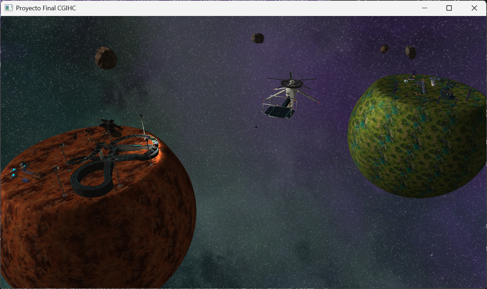

# Proyecto Final – Sistema Interplanetario

Proyecto final del Laboratorio de **Computación Gráfica e Interacción Humano-Computadora**
Facultad de Ingeniería, UNAM · Semestre 2027-1 · Grupo de laboratorio 02

Ambiente virtual interactivo en **C++ y OpenGL 3.3** con las temáticas *Viajes espaciales* y *Evolución de especies intergalácticas*. La escena tiene dos planetas, un cinturón de asteroides, un satélite, una estación espacial entre ambos planetas, una pista de carreras, una plataforma de lanzamiento y personajes de distintos universos ficticios.

   

---

## Equipo

| Integrante | Personaje | Universo |
|---|---|---|
| Baeza Álvarez Isaura | Goku niño | Dragon Ball |
| De León López Alexis | Shigeo Kageyama "Mob" | Mob Psycho 100 |
| Loza Regino Miguel Ángel | Sigismund | Templarios Negros, Warhammer 40k |
| Romero Zamorano Rosa Jennifer | Rocky | Proyecto Hail Mary |

---

## Videos

- **Video demo:** [Ver en YouTube](https://youtu.be/Gnrf-rTyFrk)
- **Videoblog:** [Ver en YouTube](https://youtu.be/yES0VG_ZRC4)

---

## Contenido de la escena

### Planeta 1 – Extracción
- **Avatar insectoide** (personaje principal): modelo jerárquico de 6 piezas (cuerpo, cabeza y cuatro patas) con animación de caminata y linterna en la cabeza.
- **Mina**: vetas de roca con cristales que brillan, torre de extracción con taladro animado, banda, acopio y luminaria.
- **Pista de carreras** en forma de 8 con **6 naves** compitiendo en dos carriles y **6 reflectores** que siguen a su nave.
- **Fauna hostil**: el Tillagemon (jefe, animado por piezas con 3 clips), un alien agachado, un alien de patas largas y un alien alado que vuela en círculos.
- **Sigismund** (armado por piezas, dispara su pistola bolter al Tillagemon) y **Mob** (levita y levanta rocas).

### Planeta 2 – Refinamiento
- **Refinería**: banda transportadora donde el mineral bruto se convierte en lingotes, refinadora y separadora con engranajes, depósitos, almacén, contenedores y paneles solares.
- **Plataforma de lanzamiento** con cohete, brazos de soporte, llamas del motor y humo.
- **Rocky** revisando la consola de la refinería y **Goku** volando en su nube.
- Cápsula y vegetación alienígena.

### Espacio
- **Estación espacial** a la mitad entre los dos planetas, con muelle de atraque y dos lanzaderas que entran y salen.
- **Nave de transporte** que viaja planeta 1 → estación → planeta 2 → estación → planeta 1.
- **Cinturón de asteroides** con forma y textura procedurales (cada asteroide es distinto).
- **Satélite** en órbita alrededor del planeta de refinamiento.
- **Skybox distinto para cada planeta**.

---

## Controles

### Cámaras

| Tecla | Cámara |
|---|---|
| `1` | Avatar en el planeta 1 (tercera persona, sobre el piso) |
| `2` | Avatar en el planeta 2 (tercera persona, sobre el piso) |
| `3` | Nave de transporte viajando entre planetas |
| `4` | Cámara panorámica libre |
| `5` | Nave de la carrera (tercera persona) |
| `6` | Plataforma de lanzamiento |
| `7` | Estación espacial y atraques |
| `8` | Seguir a una lanzadera de la estación |
| `9` | Goku en su nube |
| `0` | Vista de la refinería |
| `P` | Vista de la mina |

### Movimiento

| Tecla | Acción |
|---|---|
| `W` `A` `S` `D` | Caminar con el avatar / mover la cámara libre |
| Mouse | Girar la vista |
| `Shift` | Correr (x3 con el avatar, x10 en la cámara libre) |
| `Esc` | Salir |

### Interacciones

| Tecla | Acción |
|---|---|
| `L` | Prender / apagar la linterna del avatar |
| `Z` `X` `C` `G` `H` `N` | Prender / apagar cada reflector de la pista |
| `Q` | Prender / apagar todos los reflectores |
| `B` | Lanzar el cohete (cuenta atrás de 3 s) |
| `R` | Regresar el cohete a la plataforma |
| `V` | Ciclo del taladro de la mina |
| `M` | Pausar / reanudar la producción de la refinería |
| `T` | Ataque del Tillagemon: horquillazo |
| `Y` | Ataque del Tillagemon: azotón |
| `F` | Sigismund dispara tres veces al Tillagemon |
| `U` | Mob levita |
| `I` | Rocky inspecciona la consola |

---

## Implementación

### Modelos jerárquicos
| Elemento | Archivo | Jerarquía |
|---|---|---|
| Avatar insectoide | `AvatarJerarquico.h` | cuerpo → cabeza, 4 patas |
| Tillagemon | `TillagemonJerarquico.h` | 19 piezas: cadera → torso → brazos → antebrazos → horquilla, piernas |
| Sigismund | `SigismundJerarquico.h` | cuerpo → hombro → codo → muñeca → pistola |
| Reflectores | `ReflectoresPista.h` | poste → yugo → cuerpo → spotlight |
| Plataforma | `LanzamientoEspacial.h` | plataforma → brazos; cohete → llamas |
| Refinería | `PlantaRefinamiento.h` | máquinas → engranajes |
| Lanzaderas | `EstacionEspacial.h` | nave → brillo del motor |

### Iluminación
- **Luz direccional** con ciclo día/noche de **120 segundos**.
- **Luces puntuales**: cinco luminarias (plataforma, refinería y mina) que se prenden y apagan juntas al llegar la noche, más la luz del motor del cohete y el fogonazo de la pistola de Sigismund.
- **Spotlights**: linterna del avatar y 6 reflectores de la pista, controlados con teclado.
- **Emisión y mapas de emisión** para llamas, balizas, ventanas de la estación y cristales.

### Animaciones activadas con teclado
Lanzamiento del cohete, taladro de la mina, ataques del Tillagemon, disparo de Sigismund, levitación de Mob, inspección de Rocky, pausa de la refinería y reflectores.

### Animaciones continuas (por funciones y algoritmos)
| Animación | Técnica |
|---|---|
| Carrera de naves | Curva de Hermite entre 95 puntos clave; ritmo de cada nave variado con un seno |
| Goku en su nube | Elipse paramétrica; orientación con la tangente |
| Transporte y lanzaderas | Rutas por puntos clave con *smoothstep* |
| Asteroides | Órbita, rotación propia, deformación por ruido 3D y textura procedural (fBm + Worley) |
| Satélite y alien alado | Órbitas circulares con vaivén senoidal |
| Refinería | Piezas en ciclo sobre la banda |
| Reflectores | Seguimiento de su nave con `atan2` y suavizado exponencial |
| Tillagemon | Ciclo de reposo por keyframes con *slerp* |

### Shaders
- `shader_light.vert` / `shader_light.frag`: Phong con luz direccional, puntual y spotlight; textura triplanar para los planetas; roca procedural para los asteroides; emisión, opacidad y corte por alfa.
- `skybox.vert` / `skybox.frag`: cubemap del fondo.

---

## Compilación y ejecución

**Dependencias:** OpenGL 3.3, GLEW, GLFW, GLM, Assimp y stb_image (incluido).

1. Abrir la solución en Visual Studio.
2. Compilar en modo **Release**.
3. Junto al ejecutable deben estar:
   - las carpetas `Models/`, `Textures/` y `shaders/`;
   - las DLL de GLEW, GLFW y Assimp.
4. Ejecutar. La consola muestra el tiempo de carga de cada modelo y la lista de controles.

Las rutas de modelos y texturas son relativas, así que el programa debe ejecutarse desde la carpeta que contiene `Models/`, `Textures/` y `shaders/`.

> Los modelos y texturas están comprimidos. Antes de ejecutar, descomprime `Models.zip` y `Textures.zip` en la carpeta raíz del proyecto, de modo que queden las carpetas `Models/` y `Textures/` junto al ejecutable.

### Estructura
```
Proyecto-Final.cpp        Programa principal
*.h / *.cpp               Clases del proyecto y de la base de la clase
shaders/                  Vertex y fragment shaders
Models/                   Modelos .obj con sus .mtl
Textures/                 Texturas y skyboxes
```

---

## Créditos

### Modelos y texturas

| Recurso | Fuente |
|---|---|
| Skybox | [Space 3D](https://wwwtyro.github.io/space-3d/) |
| Avatar insectoide | [Ungubis eléctrica](https://sketchfab.com/3d-models/ungubis-electrica-75404adcba264c6fafc32384aa61da87) (Sketchfab) |
| Rocky | [Project Hail Mary – Rocky](https://sketchfab.com/3d-models/project-hail-mary-rocky-853f49d0b6a7416b8b7c48c619d01798) (Sketchfab) |
| Goku | [Son Goku and Kintoun Nimbus](https://sketchfab.com/3d-models/son-goku-and-kintoun-nimbus-0e05229282e644ab978d7d9c09ab4ec2) (Sketchfab) |
| Sigismund | [Dark Crusader Marshall in Heavy Armour](https://cults3d.com/es/modelo-3d/juegos/dark-crusader-marshall-in-heavy-armour) (Cults3D) |
| Mob | [Model DL: Mob Psycho 100](https://www.deviantart.com/wolfblade111/art/Model-DL%3A-Mob-Psycho-100-865880516) (DeviantArt, wolfblade111) |
| Asteroide 1 | [Asteroid 4 Vesta](https://science.nasa.gov/3d-resources/asteroid-4-vesta-a/) (NASA) |
| Asteroide 2 | [Asteroid 1620 Geographos](https://science.nasa.gov/3d-resources/asteroid-1620-geographos/) (NASA) |
| Asteroide 3 | [Asteroid 8567 1996 HW1](https://science.nasa.gov/3d-resources/asteroid-8567-1996-hw1/) (NASA) |
| Nave Saiyajin | [Sketchfab](https://skfb.ly/pqXS8) |
phm-myship--proyect-hail-mary-da729a0725d545dd8e912925a931ac88) (Sketchfab) |
| Nave 1 | [Space Ship](https://sketchfab.com/3d-models/space-ship-f1ae5b5847434f72909910c1af9592ed) (Sketchfab) |
| Flor 1 | [Alien Flower](https://sketchfab.com/3d-models/alien-flower-b75df2333b914f529058134e9e3fadac) (Sketchfab) |
| Flor 2 | [Hollow Bloom Alien Plant](https://sketchfab.com/3d-models/hollow-bloom-alien-plant-02f7d024ebee4bc6b690b92af6bec66a) (Sketchfab) |
| Cristales | [Glowing Crystals](https://sketchfab.com/3d-models/glowing-crystals-1c2e277c8c6b4c379ae55099c3122db1) (Sketchfab) |
| Reflectores | "Reflector Halo AdiXXioN" por [AdiXXioN](https://sketchfab.com/adixxion), licencia CC-BY-4.0 |

### Código
- `Sphere` y `definition.h`: basados en el código de Reynaldo Martell.
- [stb_image](https://github.com/nothings/stb) de Sean Barrett (dominio público).
